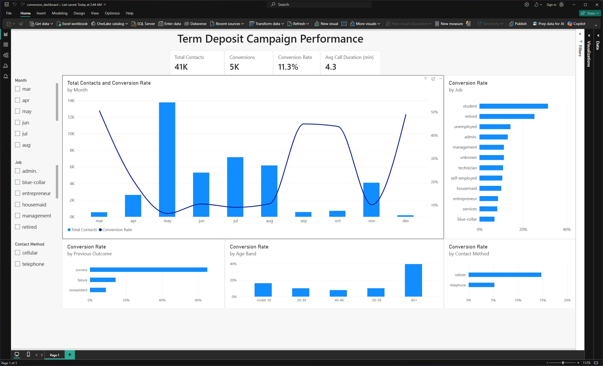

# Campaign Performance Dashboard (Power BI)

An interactive Power BI dashboard built on the same 41,188 term deposit campaign records used for the predictive model in this repository. Where the model answers "who is likely to convert", the dashboard answers "where did the campaign spend its effort, and was that the right place".



## Why a dashboard alongside the model

A classification model is consumed by a system. A dashboard is consumed by the people who decide how to run the next campaign. Building both makes the project end to end in the way a business actually experiences it: the model scores leads, and the reporting layer tells the campaign manager whether the strategy behind those calls is working.

## Headline metrics

| Metric | Value |
|---|---|
| Total contacts | 41,188 |
| Conversions | 4,640 |
| Conversion rate | 11.3% |
| Average call duration | 4.3 minutes |

## What the data shows

**1. Campaign effort was pointed at the worst-performing month.**
May absorbed roughly a third of all outreach and converted at one of the lowest rates in the dataset. March, September, October and December each converted several times better on a fraction of the volume. The volume and rate series are deliberately plotted on the same chart because the gap between them is the finding.

**2. The warm list was underused.**
Customers who converted in a previous campaign convert again at a dramatically higher rate than customers never previously contacted. Despite that, the never-contacted group makes up the overwhelming majority of outreach. Per call, the previous-success list is worth several times a cold contact.

**3. Channel matters more than it looks.**
Cellular contacts convert at roughly three times the rate of landline contacts.

**4. The best segments sit at both ends of the age range.**
Students and retirees convert far better than everyone in between, a pattern the Job and Age Band charts confirm independently.

## Recommendation

Shift volume out of May toward the higher-converting months, prioritise the previous-success list ahead of cold outreach, and default to cellular contact where a number is available.

## How it was built

**Data preparation (Power Query)**
- Imported the semicolon-delimited source file with explicit delimiter and type handling
- Renamed columns for presentation, since visual labels inherit column names
- Derived `Converted`, a numeric 1/0 flag, because conversion rate cannot be computed from a text yes/no field
- Derived `Month Number` and `Age Band Number` as hidden sort keys, so categorical axes order chronologically and by age rather than alphabetically
- Banded raw age into five groups to make the segment readable

**Model layer (DAX)**

Conversion rate is defined once as a measure rather than repeated per visual, so every chart on the page agrees with every other and recalculates correctly under any slicer combination.

```
Total Contacts        = COUNTROWS(Campaign)
Conversions           = SUM(Campaign[Converted])
Conversion Rate       = DIVIDE([Conversions], [Total Contacts])
Avg Call Duration     = DIVIDE(AVERAGE(Campaign[Call Duration]), 60)
```

`DIVIDE` is used in place of the division operator so that filtering to an empty segment returns blank rather than breaking the visual.

**Report layer**
- KPI cards ordered as a funnel: contacts, conversions, rate, duration
- Combination chart pairing contact volume against conversion rate by month
- Segment breakdowns by job, previous outcome, age band and contact method
- Slicers on month, job and contact method, filtering the full page

## A note on `duration`

The `duration` column is excluded from the predictive model in this repository because its value is only known after a call has ended, which makes it unusable for scoring a lead in advance. It appears on the dashboard as a descriptive metric, where reporting on what already happened is the intent rather than predicting what will.

## Files

```
dashboard/
├── conversion_dashboard.pbix      # Power BI source file
├── conversion_dashboard.pdf       # Static export
├── dashboard_overview.jpg         # Full dashboard
└── dashboard_filtered.jpg         # Filtered view showing interactivity
```

## Tools

Power BI Desktop, Power Query (M), DAX
